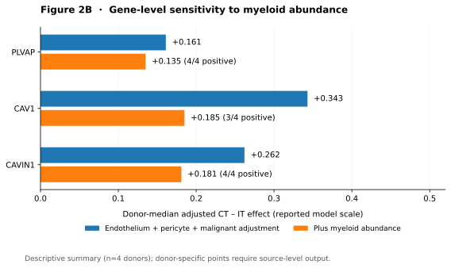

# GBM–BTB Regional Transcriptional Remodeling — V1.6

**Independent research project | Working results release (2026-11-01)**  
**研究项目独立仓库 · V1.6 工作稿**  
[中文说明](README_zh-CN.md) · [Full findings / 完整发现](docs/MAIN_FINDINGS.md)

## Research question

Do histopathologically annotated infiltrative-tumor (IT) and cellular-tumor (CT) regions of glioblastoma (GBM) show distinct vascular/blood–tumor barrier (BTB)-associated transcriptional profiles, and which associations remain after tissue-composition adjustment?

## Three principal findings

| Finding | GBM-Space observation | Interpretation |
|---|---|---|
| **Opposing anatomical module patterns** | IT→CT junction-associated module **−0.25278** and transcytosis-associated module **+0.21665**; both **4/4 donors** concordant across **17 eligible Visium sections** | **Tissue-level RNA association**, not measured permeability or endothelial vesicle transport |
| **PLVAP regional robustness** | IT→CT effect **+0.161** after base composition adjustment, **+0.135** after additional myeloid adjustment; **4/4 donors** positive | A modest but directionally robust regional association under the tested models |
| **Endothelial remodeling-associated state** | **2,241 endothelial nuclei / 12 donors**: higher PLVAP detection (**12/12**), higher PLVAP pseudobulk (**11/12**), lower MFSD2A pseudobulk (**10/12**) | Cell-resolved endothelial state, **not directly localized** to individual IT/CT spots |

**Statistical boundary:** For 4/4 concordant donors, the two-sided exact sign-test is **P = 0.125**, not conventional significance. The spatial module contains `CAV1`, whose regional expression is sensitive to composition adjustment; PLVAP effect sizes are small. No direct barrier permeability, drug-delivery, reversibility, or perturbation assays were performed.

## Figures



*Figure 2B is a **summary-level draft visualization** of reported donor-median effects, not a donor-resolved final publication figure.*

## Repository structure

```text
README.md                       English project overview
README_zh-CN.md                 中文项目介绍
docs/MAIN_FINDINGS.md            Detailed bilingual results and boundaries
docs/DATA_SOURCES.md             Provenance, roles and scope of public resources
docs/RELEASE_NOTES.md            V1.6 work-in-progress status and known gaps
results/region_module_effects.csv
results/gene_adjustment_sensitivity.csv
results/endothelial_state_summary.csv
figures/Figure2B_summary.svg
figures/Figure2B_summary.svg
```

These `results/` tables reproduce **reported manuscript summary values**. They are **not raw RNA-seq/Visium data**, do not include spot-level or donor-level observations, and must **not** be treated as a fully reproducible analysis release. No new patients or experiments are represented.

## Data sources

Primary discovery: [GBM-Space](https://www.gbmspace.org/) (Visium + snRNA). Complementary studies: [GSE162631](https://www.ncbi.nlm.nih.gov/geo/query/acc.cgi?acc=GSE162631), [Ivy GAP / GSE107559](https://www.ncbi.nlm.nih.gov/geo/query/acc.cgi?acc=GSE107559), and [Xenium S2/S6 source](https://doi.org/10.5281/zenodo.17622242). The same GBM-Space atlas supplied both the spatial and single-nucleus layers, **not independent discovery cohorts**. See [DATA_SOURCES](docs/DATA_SOURCES.md).

## Project and manuscript status

**V1.6 — working scientific summary, not a peer-reviewed acceptance or functional BTB validation.** This repository is deliberately separate from the existing `ZLCHN-AI/gbm-btb-spatial-remodeling` source-code repository; creating it does not alter that earlier repository. The compiled summary does not assert a full re-executable computational pipeline. Original public datasets remain governed by their source terms; no third-party raw datasets are redistributed here.